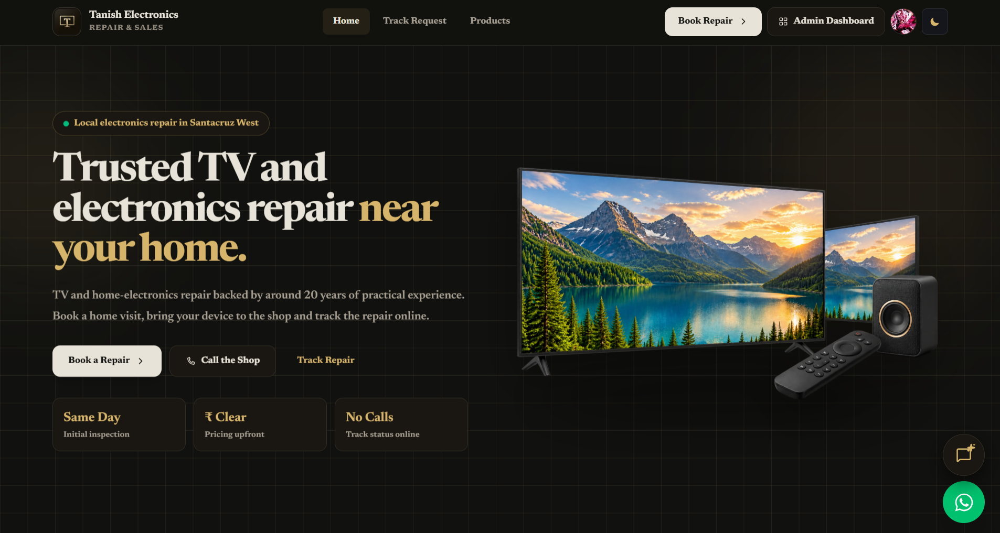
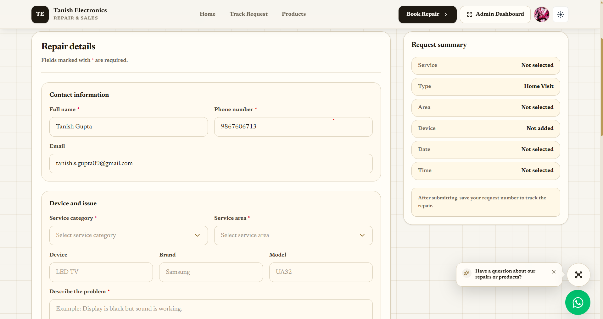
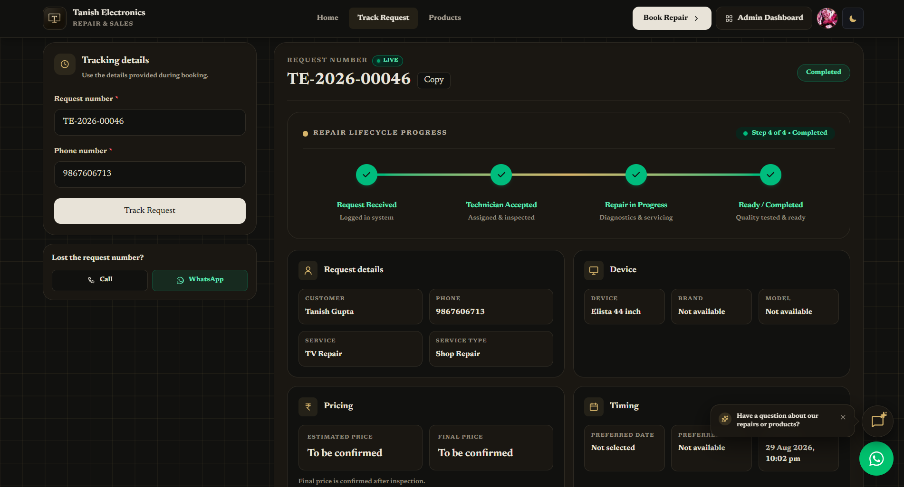
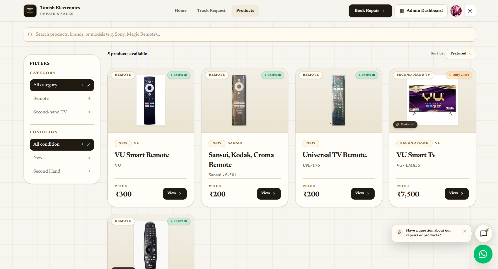
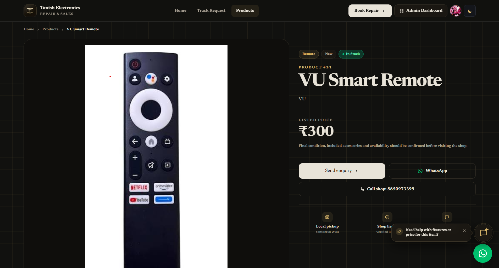
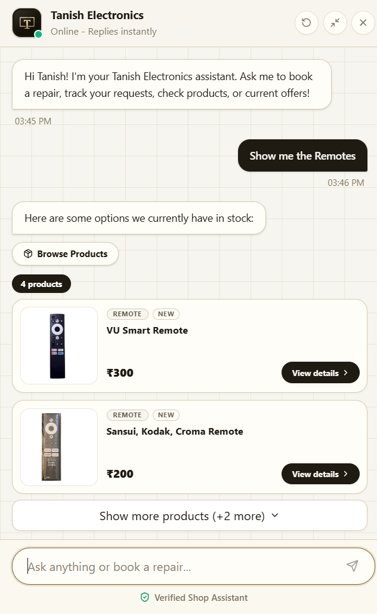
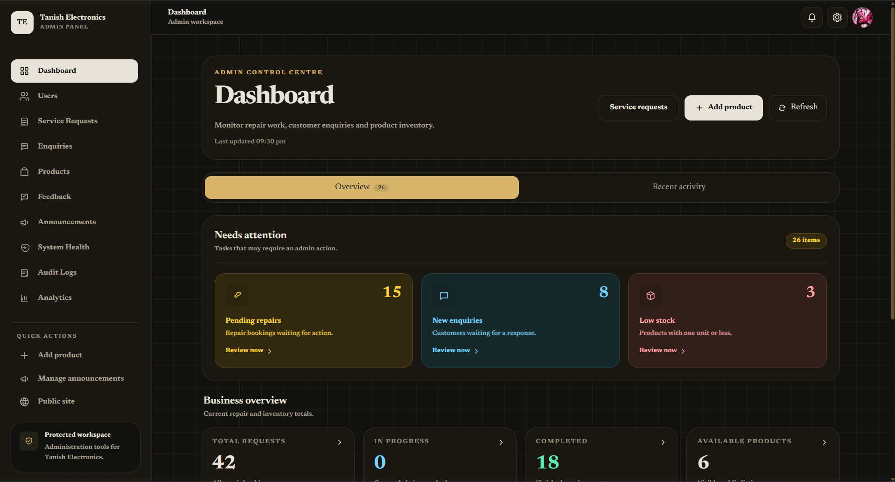

<p align="center">
  
</p>

> Tanish Electronics is a full-stack web platform for an electronics repair and sales shop. Customers can book repair requests for devices like TVs, Bluetooth speakers, home theatres, and remotes (with images), track their request status in real time, and select an in-shop visit or technician for home visit (for TVs). Admins can review, approve, and update repair requests, and manage sales of products like second-hand TVs and new remotes. The platform also features an intelligent AI Assistant powered by Groq LLaMA that handles conversational repair bookings, live tracking, in-stock product searches with rich cards, and product-aware enquiries. Built with a C# (ASP.NET Core) backend using Entity Framework Core and SQL Server, SignalR for real-time updates, and a React + TypeScript frontend.

## Features

**Customer**

- Book a repair request for a specific device (TV, Bluetooth speaker, home theatre, remote, etc.)
- Upload images of the device/issue while booking the request
- Choose between visiting the shop or requesting a home visit by a technician (with flexible shop-configured home visit policies)
- **SignalR Real-Time Live Repair Tracking**: Instant live push updates on `/track-request` and `/account/repairs/:id` whenever a technician or admin updates status, pricing, or diagnosis notes (with glowing `LIVE` indicator and real-time alert banners)
- **Interactive 4-Stage Repair Lifecycle Stepper**: Clear visual progress across _Request Received → Technician Accepted → Repair in Progress → Ready / Completed_ (with 100% checkmark resolution on completion and dedicated cancelled state)
- **Mobile Navigation with User Avatar & Dashboard Quick Actions**: Header contains theme switcher, direct Dashboard link, and interactive `UserAccountMenu` avatar widget on mobile view
- Browse and purchase products — second-hand TVs, new remotes, and accessories with category/condition filters
- Submit product and callback enquiries directly from product pages or the contact section
- Real-time notification bell with SignalR live pushes for repair progress updates

**AI Assistant (Groq Cloud LLM)**

- **In-Chat Repair Booking**: Conversational step-by-step repair booking that directly registers service requests in the database and generates tracking numbers (`TE-2026-XXXXX`)
- **Fault-Aware Intent Separation**: Distinguishes hardware fault symptoms (horizontal lines, flickering, no sound) from buying requests, ensuring customers are guided straight to repair booking
- **Product-Aware Enquiries**: Automatically detects the active product page or discussed item and creates direct product-linked enquiries in the Admin Panel
- **Real-Time Repair Tracking**: Instant status, price estimation, and diagnosis lookups via request number and phone number directly in chat
- **Interactive Product Search**: Real-time inventory searches that render interactive product cards with photos, prices, category badges, and direct navigation links
- **Live Knowledge Grounding & Semantic Vector RAG**: Dynamically grounded in real-time shop hours, contact numbers, service areas, active announcements, verified customer reviews, and high-performance in-memory cosine similarity vector search (`KnowledgeVectorService`) that retrieves authoritative workshop diagnostics, root causes, component fixes, and repair warranties from the SQL knowledge base
- **Proactive Page Awareness**: Contextual prompt bubbles and guidance tailored to the user's active page (`/`, `/products`, `/products/:id`, `/book-repair`, `/track-request`)
- **High-Speed SSE Streaming**: Real-time token streaming with tag-suppression token buffering to seamlessly hide background system action tags
- **Modular Partial Class Architecture**: Clean separation into `Grounding`, `Prompt`, `Handlers`, `Reply`, `Stream`, and `Core` partial files

**Admin & Observability**

- View incoming repair requests with full customer details and issue images
- Approve/reject a customer's repair request and manage repair work/diagnosis notes with instant SignalR customer broadcast
- Set estimated and final repair pricing
- Update the status of a repair request (e.g. Pending → Approved → In Progress → Completed)
- **AI Store Knowledge Base Manager (`/admin/store-knowledge`)**: Full administrative CRUD workspace for managing authoritative diagnostic solutions, warranties, and Mumbai home visit policies grounding the AI Assistant
- **Enterprise System Health & Telemetry**: Live 7-point health check suite monitoring SQL Server, User Sessions, In-Memory Cache, Server Host RAM / GC Heap, Server Storage, Media Uploads, and Groq Cloud AI with 3-minute in-memory caching to eliminate rate limit spam
- **Responsive Telemetry Dashboard**: Real-time admin monitoring dashboard with smooth Catmull-Rom Bézier response trend curves, mobile 2x2 grid, and category filter tabs
- View audit logs, website visit analytics, user management, and data exports (CSV/Excel)

## Tech Stack

**Backend**

- C# (.NET / ASP.NET Core, .NET 10.0)
- Entity Framework Core (ORM)
- Groq API (High-performance Groq Cloud LLM for real-time conversational reasoning & tag extraction)
- SignalR (`RepairTrackingHub`, `AnnouncementHub`, `NotificationHub` for real-time tracking, announcements, and notification pushes)
- Custom JWT auth with server-side session revocation
- BCrypt (hashing password and OTP codes)
- RBAC (Role-Based Access Control) via policy-based authorization
- Google Auth (OAuth sign-in)
- Email Service via MailKit (notification, OTP verification with Google App Password)
- OTP verification (expiry, resend cooldown, max attempts)
- Rate limiting (per-endpoint policies: login, OTP, uploads, admin actions)
- Advanced Health Checks (SQL Server, Cache, Host RAM, Disk Storage, Media Uploads, Groq AI)
- Output caching (public/products endpoints)
- Audit logging

**Frontend**

- React + TypeScript (Vite)
- React Router (routing)
- React Hook Form (form handling)
- Tailwind CSS (styling)
- Lucide React (icons)
- Custom SSE streaming client with real-time token accumulation & tag suppression
- jsPDF + html2canvas (generating PDFs, e.g. receipts)
- @microsoft/signalr (real-time repair tracking and notification clients)

## Project Structure

```
TanishElectronics\
├── Readme.md
├── .gitignore
├── screenshots\
├── Backend/
│   └── TanishElectronics.Api/
|       ├── Program.cs
|       ├── TanishElectronics.sql      # DB schema — tables, indexes
│       ├── Authorization/
│       ├── BackgroundServices/
│       ├── Constants/
│       ├── Controllers/
│       │   ├── Admin/
│       │   ├── Auth/
│       │   ├── Customer/
│       │   └── Public/
│       ├── Data/
│       ├── Delegates/
│       ├── DTOs/
│       │   ├── Admin/
│       │   │   ├── Analytics/
│       │   │   ├── Announcements/
│       │   │   ├── AuditLogs/
│       │   │   ├── Dashboard/
│       │   │   ├── Enquiries/
│       │   │   ├── Exports/
│       │   │   ├── Feedback/
│       │   │   ├── Notifications/
│       │   │   ├── Products/
│       │   │   ├── ServiceRequests/
│       │   │   ├── Settings/
│       │   │   └── Users/
│       │   ├── Auth/
│       │   │   ├── Google/
│       │   │   ├── LogInOut/
│       │   │   ├── OTP/
│       │   │   ├── Passwords/
│       │   │   └── Session/
│       │   ├── Common/
│       │   ├── customer/
│       │   │   ├── dashboard/
│       │   │   ├── Feedback/
│       │   │   ├── notification/
│       │   │   ├── profile/
│       │   │   └── Repairs/
│       │   ├── Enquiries/
│       │   ├── Products/
│       │   ├── Public/
│       │   │   ├── Announcements/
│       │   │   ├── ChatBot/       # Chatbot request, response & stream event DTOs
│       │   │   └── Feedbacks/
│       │   └── ServiceRequests/
│       ├── Entities/
│       ├── Enums/
│       │   └── Auth/
│       ├── Events/
│       │   └── Products/
│       ├── Exceptions/
│       ├── HealthChecks/
│       ├── Helpers/
│       ├── Hubs/           # SignalR hubs (live repair tracking, notifications & announcements)
│       ├── Interfaces/
│       │   ├── Common/
│       │   ├── Events/
│       │   ├── Repositories/
|       |   |   └── IAuth/
│       │   └── Services/
|       |       └── IAuth/
│       ├── Middleware/
│       ├── Migrations/     # EF Core migrations
│       ├── Models/
│       ├── Properties/
│       ├── Repositories/
|       |   └── Auth/           # All Separated Auth Repostories
│       ├── Services/           # Business services & ChatbotService (Groq LLaMA)
│       |   ├── ChatBotService/  # Separated files of chatbot services
|       |   └── Auth/           # All Separated Auth Service
|       |       ├── Context/
|       |       └── Helpers/
|       ├── Settings/       # AppSettings, GroqSettings, ShopSettings
│       └── wwwroot/
│           └── uploads/
│               ├── announcements/        # Announcement Images
│               ├── products/             # Products Display Images
│               └── service-requests/     # Customer Side Service Request Images
│
└── Frontend/
    └── tanish-electronics-web/
        ├── public/
        ├── images/
        └── src/
            ├── App.tsx
            ├── components/
            │   ├── auth/
            │   ├── common/     # ChatWidget AI Assistant & Shared UI
            │   ├── customer/
            │   ├── layout/
            │   ├── public/
            │   └── UI/
            ├── contexts/
            ├── hooks/
            ├── Pages/
            │   ├── account/
            │   ├── admin/
            │   ├── auth/
            │   └── customer/
            ├── Services/
            ├── Types/
            └── utils/
```

## Prerequisites

- [.NET SDK](https://dotnet.microsoft.com/download) (version 10.0 or higher)
- [Node.js](https://nodejs.org/) (version 18.0 or higher / LTS) and npm
- [SQL Server](https://www.microsoft.com/sql-server)

## Database

The full schema (tables, indexes, constraints) is defined in `TanishElectronics.sql` at the Backend folder root. Run the script against your SQL Server instance to set up the database, or use the EF Core migrations in `Backend/TanishElectronics.Api/Migrations/`.

## Getting Started

### 1. Clone the Repository

```bash
git clone https://github.com/Tanish15-gif/tanish-electronics.git
cd tanish-electronics
```

### 2. Backend Setup

```bash
cd Backend/TanishElectronics.Api
```

Update the connection string in `appsettings.json` to point to your SQl Server instance:

```json
"ConnectionStrings":{
    "DefaultConnection": "Server={Server_Name};Database=TanishElectronicsDb;Trusted_Connection=True;TrustServerCertificate=True;"
}
```

```bash
dotnet ef database update
```

Run the backend:

```bash
dotnet run
```

The API should now be running at `http://localhost:XXXX`.

### Frontend Setup

```bash
cd Frontend/tanish-electronics-web
npm install
npm run dev
```

The app should now be running at `http://localhost:5173` (or whichever port VITE/CRA assigns).

## Environment Variables

```
VITE_API_BASE_URL=/api
VITE_GOOGLE_CLIENT_ID=google-client-id-here
```

> ⚠️ Never commit real values here — these are placeholder names only. Keep actual secrets in `appsettings.Development.json` / .NET User Secrets (backend) and a local `.env` file (frontend), both excluded via `.gitignore`.

## API Endpoints

Full route list generated from the live OpenAPI spec (`/openapi/v1.json`).

<details>
<summary><strong>Auth</strong> — Custom JWT + Google OAuth + sessions</summary>

| Method | Endpoint                                       | Description                                          |
| ------ | ---------------------------------------------- | ---------------------------------------------------- |
| POST   | `/auth/custom/register`                        | Register a new account                               |
| POST   | `/auth/custom/login`                           | Login with email/password                            |
| POST   | `/auth/custom/google`                          | Login/register via Google                            |
| POST   | `/auth/custom/refresh`                         | Refresh access token                                 |
| POST   | `/auth/custom/logout`                          | Logout current session                               |
| POST   | `/auth/custom/change-password`                 | Change password                                      |
| POST   | `/auth/custom/forgot-password/request`         | Request password reset OTP                           |
| POST   | `/auth/custom/forgot-password/verify`          | Verify password reset OTP                            |
| POST   | `/auth/custom/forgot-password/reset`           | Reset password with token                            |
| POST   | `/auth/custom/set-password/google-reauth`      | Re-authenticate via Google before setting a password |
| POST   | `/auth/custom/set-password/complete`           | Complete password setup                              |
| GET    | `/auth/custom/security-summary`                | Get account security overview                        |
| GET    | `/auth/custom/sessions`                        | List active sessions                                 |
| GET    | `/auth/custom/sessions/validate`               | Validate current session                             |
| POST   | `/auth/custom/sessions/{userSessionId}/revoke` | Revoke a specific session                            |
| POST   | `/auth/custom/sessions/logout-others`          | Log out all other sessions                           |
| POST   | `/auth/custom/sessions/logout-all`             | Log out all sessions                                 |

</details>

<details>
<summary><strong>Customer — Repairs & Announcements</strong></summary>

| Method | Endpoint                                        | Description                                  |
| ------ | ----------------------------------------------- | -------------------------------------------- |
| POST   | `/ServiceRequests`                              | Submit a new repair request                  |
| POST   | `/ServiceRequests/{serviceRequestId}/images`    | Upload images for a repair request           |
| GET    | `/ServiceRequests/track`                        | Track a request by request number and phone  |
| GET    | `/CustomerRepairs/{serviceRequestId}`           | Get repair request details                   |
| GET    | `/CustomerRepairs/feedbacks`                    | Get customer's submitted feedback            |
| GET    | `/CustomerRepairs/{serviceRequestId}/feedback`  | Get feedback for a repair request            |
| POST   | `/CustomerRepairs/{serviceRequestId}/feedback`  | Submit feedback for a completed repair       |
| GET    | `/customer/announcements`                       | Get announcements for the logged-in customer |
| GET    | `/customer/announcements/popup`                 | Get popup announcement                       |
| POST   | `/customer/announcements/{announcementId}/view` | Mark an announcement as viewed               |

</details>

<details>
<summary><strong>Customer — Profile, Dashboard & Notifications</strong></summary>

| Method | Endpoint                                         | Description                     |
| ------ | ------------------------------------------------ | ------------------------------- |
| GET    | `/CustomerDashboard`                             | Get customer dashboard summary  |
| GET    | `/CustomerProfile`                               | Get customer profile details    |
| PUT    | `/CustomerProfile/details`                       | Update customer profile details |
| GET    | `/CustomerProfile/addresses`                     | List saved addresses            |
| POST   | `/CustomerProfile/addresses`                     | Add a new address               |
| PUT    | `/CustomerProfile/addresses/{addressId}`         | Update a saved address          |
| DELETE | `/CustomerProfile/addresses/{addressId}`         | Delete a saved address          |
| PUT    | `/CustomerProfile/addresses/{addressId}/default` | Set an address as the default   |
| GET    | `/CustomerNotifications`                         | List customer notifications     |
| PUT    | `/CustomerNotifications/{notificationId}/read`   | Mark a notification as read     |
| PUT    | `/CustomerNotifications/read-all`                | Mark all notifications as read  |

</details>

<details>
<summary><strong>Admin — Repairs, Enquiries & Feedback</strong></summary>

| Method | Endpoint                                         | Description                             |
| ------ | ------------------------------------------------ | --------------------------------------- |
| GET    | `/admin/service-requests`                        | List all repair requests                |
| GET    | `/admin/service-requests/{id}`                   | Get repair request details              |
| PUT    | `/admin/service-requests/{id}/status`            | Update repair request status            |
| PUT    | `/admin/service-requests/{id}/pricing`           | Set estimated or final repair price     |
| PUT    | `/admin/service-requests/{id}/repair-work-notes` | Add diagnosis and repair work notes     |
| GET    | `/admin/enquiries`                               | List customer enquiries                 |
| GET    | `/admin/enquiries/{id}`                          | Get enquiry details                     |
| PUT    | `/admin/enquiries/{id}/status`                   | Update enquiry status                   |
| GET    | `/admin/enquiries/{id}/notes`                    | Get internal notes for an enquiry       |
| POST   | `/admin/enquiries/{id}/notes`                    | Add an internal note to an enquiry      |
| GET    | `/admin/feedbacks`                               | List customer repair feedback           |
| PUT    | `/admin/feedbacks/{feedbackId}/public-status`    | Show or hide customer feedback publicly |

</details>

<details>
<summary><strong>Admin — Products, Announcements & Settings</strong></summary>

| Method | Endpoint                          | Description                  |
| ------ | --------------------------------- | ---------------------------- |
| GET    | `/admin/products`                 | List all products            |
| POST   | `/admin/products`                 | Add a new product            |
| GET    | `/admin/products/{id}`            | Get product details          |
| PUT    | `/admin/products/{id}`            | Update a product             |
| DELETE | `/admin/products/{id}`            | Delete a product             |
| GET    | `/admin/announcements`            | List announcements           |
| POST   | `/admin/announcements`            | Create an announcement       |
| PUT    | `/admin/announcements/{id}`       | Update an announcement       |
| DELETE | `/admin/announcements/{id}`       | Delete an announcement       |
| GET    | `/admin/store-knowledge`                 | List store knowledge articles with search & category |
| POST   | `/admin/store-knowledge`                 | Create a new store knowledge article                 |
| GET    | `/admin/store-knowledge/{id}`            | Get store knowledge article details                  |
| PUT    | `/admin/store-knowledge/{id}`            | Update a store knowledge article                     |
| DELETE | `/admin/store-knowledge/{id}`            | Delete a store knowledge article                     |
| POST   | `/admin/store-knowledge/test-similarity` | Test semantic vector cosine similarity search        |
| GET    | `/admin/settings`                        | Get shop settings                                    |
| PUT    | `/admin/settings`                        | Update shop settings                                 |

</details>

<details>
<summary><strong>Admin — Users, Analytics, Audit & Exports</strong></summary>

| Method | Endpoint                                       | Description                           |
| ------ | ---------------------------------------------- | ------------------------------------- |
| GET    | `/admin/users`                                 | List users with filtering and sorting |
| GET    | `/admin/users/summary`                         | Get user statistics summary           |
| GET    | `/admin/users/{appUserId}`                     | Get user details                      |
| PATCH  | `/admin/users/{appUserId}/status`              | Activate or deactivate a user         |
| POST   | `/admin/users/{appUserId}/unlock`              | Unlock a locked user account          |
| POST   | `/admin/users/{appUserId}/sessions/revoke-all` | Force logout a user from all sessions |
| GET    | `/admin/chat-logs`                             | List chatbot conversation transcripts |
| GET    | `/admin/chat-logs/{sessionId}`                 | Get specific session chat messages    |
| GET    | `/admin/chat-logs/stats`                       | Get chatbot telemetry and token stats |
| GET    | `/admin/dashboard/summary`                     | Get admin dashboard overview          |
| GET    | `/admin/analytics/summary`                     | Get analytics summary                 |
| GET    | `/admin/analytics/website-visits`              | Get website visit analytics           |
| GET    | `/admin/audit-logs`                            | View audit logs                       |
| GET    | `/admin/notifications`                         | List admin notifications              |
| PUT    | `/admin/notifications/{notificationId}/read`   | Mark an admin notification as read    |
| PUT    | `/admin/notifications/read-all`                | Mark all admin notifications as read  |
| GET    | `/admin/exports/service-requests`              | Export repair requests                |
| GET    | `/admin/exports/enquiries`                     | Export enquiries                      |
| GET    | `/admin/exports/products`                      | Export products                       |
| GET    | `/admin/exports/feedbacks`                     | Export customer feedback              |
| GET    | `/admin/exports/announcements`                 | Export announcements                  |
| GET    | `/admin/exports/audit-logs`                    | Export audit logs                     |
| GET    | `/admin/exports/website-visits`                | Export website visit data             |

</details>

<details>
<summary><strong>Public</strong> — No authentication required</summary>

| Method | Endpoint                      | Description                                                  |
| ------ | ----------------------------- | ------------------------------------------------------------ |
| POST   | `/public/chat`                | Send message to AI assistant (synchronous completion)        |
| POST   | `/public/chat/stream`         | Stream AI assistant reply in real-time (Server-Sent Events)  |
| GET    | `/Products`                   | Browse products with category, condition, and search filters |
| GET    | `/Products/{id}`              | Get product details                                          |
| GET    | `/public/announcements`       | Get public announcements                                     |
| GET    | `/public/feedbacks`           | Get publicly visible customer feedback                       |
| GET    | `/public/shop-settings`       | Get shop information, address, hours, and contact details    |
| POST   | `/public/website-visits`      | Log a website visit for analytics                            |
| POST   | `/Enquiries`                  | Submit a general customer enquiry                            |
| GET    | `/LookUps/service-categories` | Get available repair service categories                      |
| GET    | `/LookUps/service-locations`  | Get available service locations                              |
| GET    | `/LookUps/service-statuses`   | Get available repair status options                          |
| GET    | `/LookUps/enquiry-statuses`   | Get available enquiry status options                         |
| GET    | `/LookUps/product-categories` | Get available product categories                             |
| GET    | `/LookUps/product-conditions` | Get available product condition options                      |

</details>

## Screenshots

### Home Page (Dark Mode)



### Book Repair Request (Light Mode)



### Track Repair Status (Dark Mode)



### Products Page (Light Mode)



### Product Details Page (Light Mode)



### AI Assistant & Live In-Chat Booking (Light Mode)



### Admin Dashboard (Dark Mode)



## Future Improvements

- Technician Dashboard — a dedicated view for technicians to see their assigned repair jobs
- Repair Assignment — allow admin to assign incoming repair requests to specific technicians

## Author

GitHub: [@Tanish15-gif](https://github.com/Tanish15-gif)

## License

All rights reserved. This project and its source code are proprietary to Tanish Electronics. No part of this repository may be copied, modified, or redistributed without explicit permission from the author.

---

#### — Made By Tanish Gupta
